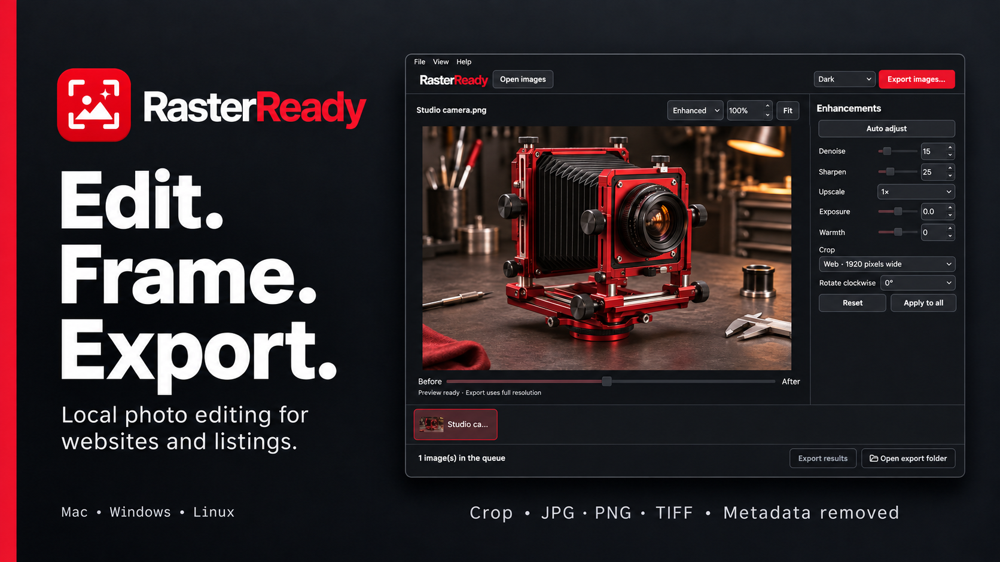

# RasterReady

Edit photos locally and prepare images for websites and sales listings. Compare before and after, adjust denoise, sharpening, exposure and warmth, then choose a preset in **Crop**. Zoom and drag to frame the image, and export JPG, PNG or TIFF copies. Embedded metadata is removed and originals are preserved.

The source on main is the 0.2.0 development version. The latest packaged release is 0.1.0. Development installers are available in the [successful GitHub Actions runs](https://github.com/rdcstout/RasterReady/actions/workflows/checks.yml) for testing.

## Download

| Platform | System | Installer |
| --- | --- | --- |
| **macOS** | Apple Silicon, macOS 26+ | **[Download DMG](https://github.com/rdcstout/RasterReady/releases/latest/download/RasterReady-macos-arm64.dmg)** |
| **Windows** | Windows 11, x64 | **[Download installer](https://github.com/rdcstout/RasterReady/releases/latest/download/RasterReady-windows-x64.exe)** |
| **Linux** | x86-64, Ubuntu 24.04/glibc 2.39+ | **[Download DEB](https://github.com/rdcstout/RasterReady/releases/latest/download/RasterReady-linux-x64.deb)** · **[AppImage](https://github.com/rdcstout/RasterReady/releases/latest/download/RasterReady-linux-x64.AppImage)** |

Downloads are free. Mac is signed and notarized; Windows is unsigned. See [installation and compatibility](docs/INSTALLATION.md) for requirements and tested platforms.

[Release notes](https://github.com/rdcstout/RasterReady/releases/latest) · [SHA-256 checksums](https://github.com/rdcstout/RasterReady/releases/latest/download/SHA256SUMS.txt)

## Get started

Open or drop photos, make adjustments in the right sidebar, and choose an aspect ratio or sizing preset from **Crop**. Use **Zoom** or the mouse wheel over the image to frame it, then drag to reposition it. **Apply to all** copies adjustments and framing to the queue.

Choose **Export images…**, enter a file name and select JPG, PNG or TIFF. Export the selected photo or the queue. Files save locally in **Downloads / file name**, using names such as Photo.jpg, Photo 2.jpg and Photo 3.jpg. Existing files are preserved.

[Usage, supported formats and limitations](docs/INSTALLATION.md#prepare-images) · [Updates, removal and recovery](docs/INSTALLATION.md)

## Help and source

[Report a bug](https://github.com/rdcstout/RasterReady/issues) · [Private security reporting](SECURITY.md) · [Contributing](CONTRIBUTING.md) · [Build from source](DEVELOPMENT.md) · [Third-party notices](THIRD_PARTY_NOTICES.md) · [MIT license](LICENSE)

Created by [Extrusion Therapy](https://extrusiontherapy.com/SoftwareRasterReady).

## Support Future Tools

You can optionally [support future Extrusion Therapy tools](https://buy.stripe.com/fZu3cw2Mnfr0d7N3ws1kA00). Downloads and source remain available without payment.
