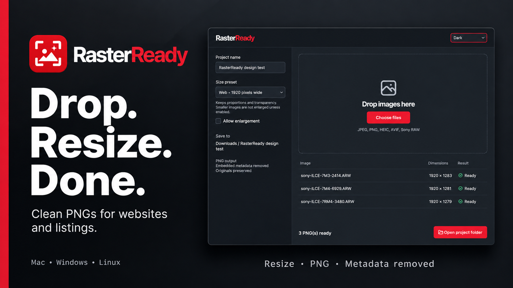

# RasterReady

Prepare images for websites and sales listings. Name a project, drop in a batch, and retrieve clean PNGs directly from **Downloads / your project name**. Embedded metadata is removed and originals are preserved.

**Release preview:** installers and the website entry are not published yet.

## Download

| Platform | System | Installer |
| --- | --- | --- |
| **macOS** | Apple Silicon, macOS 26+ | DMG · coming soon |
| **Windows** | Windows 11, x64 | Installer · coming soon |
| **Linux** | x86-64, Ubuntu 24.04/glibc 2.39+ | DEB and AppImage · coming soon |

Downloads are free. Mac is signed and notarized; Windows is unsigned. See [installation and compatibility](docs/INSTALLATION.md) for requirements and tested platforms.

[Watch for releases](https://github.com/rdcstout/RasterReady/releases). Published installers will include SHA-256 checksums.

## Get started

Enter a project name, choose a size preset, and drop images or choose files. Open the project folder when conversion finishes.

[Usage, supported formats and limitations](docs/INSTALLATION.md#prepare-images) · [Updates, removal and recovery](docs/INSTALLATION.md)

## Help and source

[Report a bug](https://github.com/rdcstout/RasterReady/issues) · [Private security reporting](SECURITY.md) · [Contributing](CONTRIBUTING.md) · [Build from source](DEVELOPMENT.md) · [Third-party notices](THIRD_PARTY_NOTICES.md) · [MIT license](LICENSE)

Created by [Extrusion Therapy](https://extrusiontherapy.com).

## Support Future Tools

You can optionally [support future Extrusion Therapy tools](https://buy.stripe.com/fZu3cw2Mnfr0d7N3ws1kA00). Downloads and source remain available without payment.
